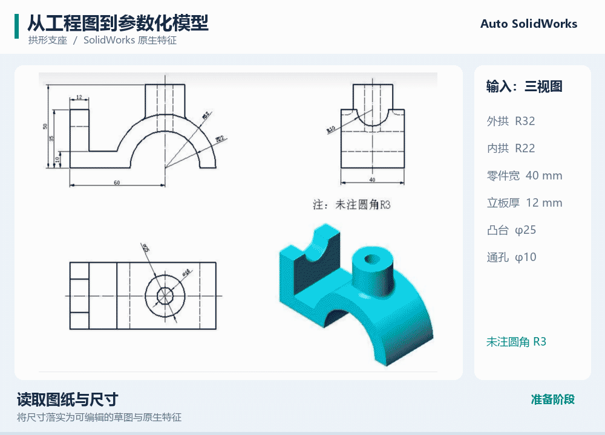
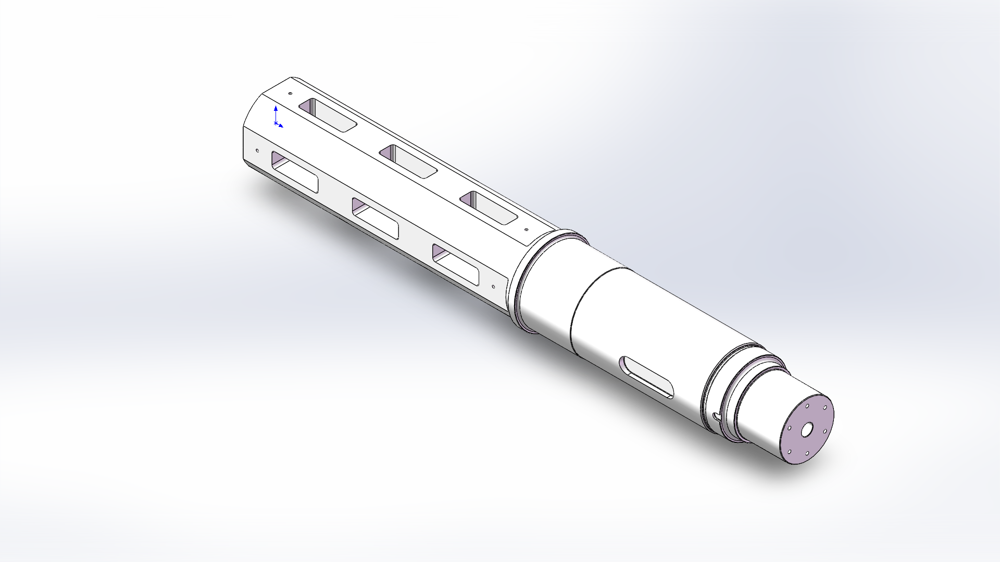

# Auto SolidWorks

**Version 1127 · 2026-11-27 · Windows x64 · Codex / MCP**

Turn drawings and dimensions into parametric models in local SolidWorks. Four default stages: **recognition → dimension binding → compile → model**, ending with a saved native file.

[简体中文](README.md) | **English**

[Download the unified Windows package](docs/download.en.md) · [Release notes](https://github.com/qdaia/Auto-SolidWorks/releases/tag/v1127)

The lite edition exposes eight tools. One Windows package selects among 11 executor builds for 2018–2026. See the [release notes](docs/release-1127.zh-CN.md) for the validation scope.

## From input to deliverable

Provide an engineering image, PDF or explicit dimensions. The plugin turns the input into an inspectable modeling plan and executes it through local SolidWorks. Continue by editing driving dimensions, checking geometry and assembly relationships, and saving editable native files.

| Workflow | Capabilities and outputs |
| --- | --- |
| Parametric parts | Sketches and constraints, extrudes, revolves, holes, fillets/chamfers, sweeps, lofts, patterns, multi-body parts, sheet metal and weldments; SLDPRT / STEP / STL |
| Design parameters | Global variables, dimension equations, configuration expressions, unit checks, feature suppression and saved readback |
| Existing models | Copy-based edits, persistent references, local/whole-model geometry checks, bounded topology history and repair receipts |
| Assemblies | Components, mates, interference checks and bounded spatial-tree mobility checks; SLDASM |
| Execution management | Execution status and results. The executor keeps its timeout, lease and recovery checks. |

## Examples

### Arched support: Modeling process

The three-view drawing and dimensions are used to create the arched base, upright wall, cylindrical boss, through hole, semicircular notch, and R3 fillets.

<p>
<a href="docs/examples/arch-support/modeling-process.gif"></a>
</p>

### Hollow shaft

The image below is a historical example. Both new from-scratch comparison attempts stopped at a curved M20 thread; this image is not release-wide acceptance evidence.

<picture></picture>

<picture><source srcset="docs/examples/hollow-shaft/drawing-preview.svg" type="image/svg+xml"></picture>

Engineering drawing PDF: `docs/examples/hollow-shaft/drawing.pdf`

## Quick start

1. Prepare Windows x64, an activated local SolidWorks installation, [.NET 9 Windows Desktop Runtime x64](https://dotnet.microsoft.com/en-us/download/dotnet/9.0), and Codex with plugin support.
2. Download and extract the [1127 Windows package](https://github.com/qdaia/Auto-SolidWorks/releases/download/v1127/auto-solidworks-1127-windows-x64.zip). Run this command in the extracted directory:

   ```powershell
   powershell -NoProfile -ExecutionPolicy Bypass -File .\install.ps1
   ```

3. Open a new Codex chat, enable **Auto SolidWorks**, and provide dimensions or a drawing:

   > Create an 80 × 50 × 10 mm mounting plate with a centered 10 mm through hole and R2 corner fillets. Save SLDPRT and STEP.

The installer prefers the CLI bundled with the Codex desktop app and prepares Interop from your local SolidWorks installation. See the [English download and installation guide](docs/download.en.md) for detailed steps and custom paths.

## Local execution and capability queries

CAD execution, native files and geometry checks run locally. Users install and license SolidWorks. The selected model interprets images and PDF pages. PDF rasterization dependencies can be configured as needed.

<!-- AUTO-SOLIDWORKS-CONTRACT:BEGIN -->
Local version: `1127`; revision: `source-four-stage-2`. Four default stages: recognition, dimension binding, compile, model. Retains real parameter/unit/source endpoint checks and native save. Removes mandatory review ledgers, material probes, previews and separate delivery review. Explicit legacy revisions retain their original rules. No full drawing/BREP/GDT equivalence claim. See [capability manifest](plugins/auto-solidworks/skills/auto-solidworks/references/capability-manifest.json).
<!-- Capability manifest SHA256: da5b1c411b6abd4f0eba30d326d137f777bbefb1e8dcdd33fd84db58d5010694 -->
<!-- AUTO-SOLIDWORKS-CONTRACT:END -->

[Basic examples](plugins/auto-solidworks/skills/auto-solidworks/basic-examples.md)

## Development and feedback

[Build and test](docs/development.en.md) · [Architecture](docs/architecture.en.md) · [Third-party notices](THIRD_PARTY_NOTICES.md) · [Report an issue](https://github.com/qdaia/Auto-SolidWorks/issues)

This project uses the MIT license; see [LICENSE](LICENSE). SolidWorks and other third-party components retain their own licenses.
