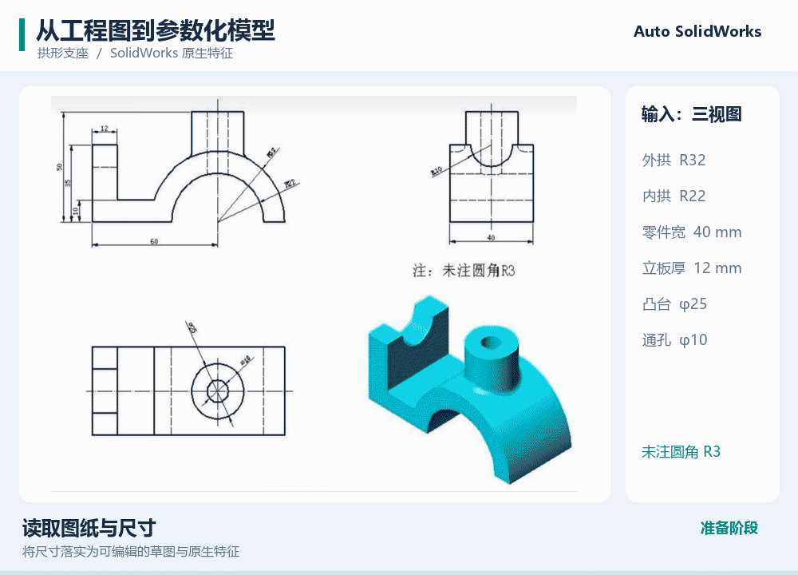
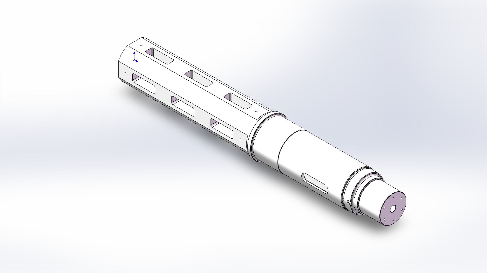

# Auto SolidWorks

**把工程图与尺寸描述转成可编辑的 SolidWorks 参数化模型。**

Auto SolidWorks 是面向 Codex / MCP 的本地 CAD 插件：在你的 SolidWorks 中创建、检查和修改零件与装配体，输出原生模型、STEP / STL 和工程图；曲线网格可交给本地 Gordon 工具生成 NURBS 曲面。

**简体中文** | [English](README.en.md)

**版本 `26.10.11`（2026 年 10 月 11 日） · Windows x64 · 16 个默认 MCP 工具（完整配置 21 个） **

[下载 Windows 插件](docs/download.zh-CN.md) · [本次新增内容](docs/release-26.10.11.zh-CN.md) · [GitHub Release](https://github.com/qdaia/Auto-SolidWorks/releases/tag/v26.10.11) · [从源码构建](docs/development.md)

## 从输入到交付

提供工程图片、PDF 或明确尺寸，插件将输入整理为可检查的建模计划，再通过本机 SolidWorks 执行。你可以继续修改驱动尺寸，检查几何与装配关系，并保存可编辑的原生文件。

| 工作内容 | 提供的能力与输出 |
| --- | --- |
| 参数化零件 | 草图与约束、拉伸、旋转、孔、圆角倒角、扫描、放样、阵列、多实体、钣金和焊件；SLDPRT / STEP / STL |
| 曲面与空间曲线 | Boundary / Fill / Sweep / Offset 的类型化控制、三维曲线与螺旋线；本地 Gordon 曲线网格与 NURBS 文件 |
| 设计参数 | 全局变量、尺寸方程、配置表达式、单位检查、特征抑制及保存后的读回 |
| 既有模型 | 副本修改、持久引用、局部及整件几何检查、限定范围的拓扑历史与修复回执 |
| 装配体 | 组件、配合、干涉检查、限定空间树机构自由度检查；SLDASM |
| 工程图 | 第一角投影视图、原生尺寸导入、视图布局与分页；SLDDRW / PDF |
| 执行管理 | 状态查询、暂停、截止时间、跨进程租约、检查点与恢复身份核对 |

## 2026 年 10 月 11 日更新（版本 `26.10.11`）
Auto SolidWorks **26.10.11** 主要优化了工程图建模过程中的重复输入和局部修改流程。新版支持在本机保存完整图纸上下文与建模草案，并**大幅减少了token消耗与增加了建模速度**。

在 **token 输入负担**方面，新版默认工具目录的文本量相比最初版本减少约 **97.16%**；包含首次完整上传、多轮复查和修正编译的测试流程，请求文本减少约 **78.75%**；空心轴一次局部修正及重编译的请求文本减少约 **99.928%**。综合token消耗约减少25%。

在 **建模用时**方面，拱形支座从零开始的对照测试中，包含识图、计划编写、原生建模、重试及导出检查的总用时，由 **9 分 19 秒缩短至 3 分 15 秒**，本次观察减少约 **65.1%**，两版成品均通过已声明的尺寸、几何和保存重开检查。该结果来自单次同会话测试，包含预热与排错经验的影响。
完整数据与边界见[中文更新说明](docs/release-26.10.11.zh-CN.md)和[测试说明](docs/benchmark-26.10.11.zh-CN.md)。

## 测试案例

### 拱形支座：建模过程

根据三视图与尺寸创建拱形底座、立板、圆柱凸台、通孔、半圆槽和 R3 圆角。

<p>
<a href="docs/examples/arch-support/modeling-process.gif"></a>
</p>

### 空心轴

下图为历史示例。本次两版从零对照均未完成曲面 M20 螺纹，不能将历史截图作为本版完整验收证据。

<picture></picture>

<picture><source srcset="docs/examples/hollow-shaft/drawing-preview.svg" type="image/svg+xml"></picture>

工程图 PDF：`docs/examples/hollow-shaft/drawing.pdf`

## 快速开始

1. 准备 Windows x64、已激活的本机 SolidWorks、[.NET 9 Windows Desktop Runtime x64](https://dotnet.microsoft.com/en-us/download/dotnet/9.0)，以及支持插件的 Codex。
2. 下载并解压 [26.10.11 Windows 安装包](https://github.com/qdaia/Auto-SolidWorks/releases/download/v26.10.11/auto-solidworks-26.10.11-windows-x64.zip)，在解压目录运行：

   ```powershell
   powershell -NoProfile -ExecutionPolicy Bypass -File .\install.ps1
   ```

3. 打开新的 Codex 聊天，启用 **Auto SolidWorks**，给出尺寸或工程图：

   > 创建一个 80 × 50 × 10 mm 的矩形安装板，中心有直径 10 mm 的通孔，四角做 R2 圆角，保存 SLDPRT 和 STEP。

安装器优先使用 Codex 桌面版自带 CLI，并从本机 SolidWorks 安装目录准备 Interop。详细步骤及自定义目录见[中文下载与安装说明](docs/download.zh-CN.md)。

## 本地运行与能力查询

CAD 执行、原生文件和几何检查在本机完成。SolidWorks 由使用者安装并授权；Gordon 另需本地 FreeCAD。图片 / PDF 的理解使用你选择的模型与服务，OCR 和 PDF 栅格化依赖可按需配置。

<!-- AUTO-SOLIDWORKS-CONTRACT:BEGIN -->
版本：`26.10.11`。通过 `cad_get_capabilities` 查询当前功能、输入约束和验证范围，或阅读[随包能力清单](plugins/auto-solidworks/skills/auto-solidworks/references/capability-manifest.json)。本版整合精简工具目录、输入／计划句柄、原子增量修改与摘要／分页结果；验收与测量范围见发布测试说明。原生案例证据按其原始修订记录。
<!-- Capability manifest SHA256: a154cbc0f3cbaf4bb5eb952ca94ef5a03fb20bd9c5654d42463f72fde2db9ea7 -->
<!-- AUTO-SOLIDWORKS-CONTRACT:END -->

[功能参数](plugins/auto-solidworks/skills/auto-solidworks/references/modeling-operations.md) · [Gordon 使用](plugins/auto-solidworks/skills/auto-solidworks/references/gordon-surface.md) · [曲面控制](plugins/auto-solidworks/skills/auto-solidworks/references/surface-modeling.md) · [几何验证](plugins/auto-solidworks/skills/auto-solidworks/references/local-geometry-verification.md)

## 开发与反馈

[源码构建与测试](docs/development.md) · [架构说明](docs/architecture.md) · [第三方声明](THIRD_PARTY_NOTICES.md) · [提交问题](https://github.com/qdaia/Auto-SolidWorks/issues)

项目使用 MIT 许可证，见 [LICENSE](LICENSE)。SolidWorks、FreeCAD 及其他第三方组件遵循各自的授权与许可。
