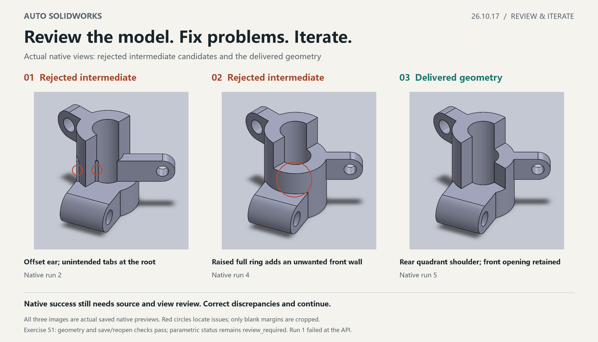

# Auto SolidWorks 26.10.17

This update focuses on **reviewing the model after creation, correcting evidence-backed problems, and iterating instead of treating the first generated model as the final deliverable.**

## Added and strengthened

### Review, correction and iteration

In the Codex-assisted plugin workflow, model creation is followed by comparison with the source drawing: critical dimensions, hole locations, feature directions, connections and necessary views. When a discrepancy has clear source evidence, the AI revises the draft, recompiles and models again, then reviews the result before deciding whether to deliver it.

Successful native execution is an intermediate result. Passing local geometry checks does not end the task when a view contradicts the drawing. If critical dimensions or topology remain uncertain, the workflow asks a specific clarification instead of silently promoting an assumption to a drawing fact.

### Save/reopen and retained evidence

Final delivery retains native save/reopen, rebuild, body validity and declared dimension/geometry checks, together with actual necessary-view review. Failed receipts, intermediate candidates, correction records and checkpoints remain available for tracing the iteration. Remaining failures and parametric limitations are disclosed.

### Latest local workflow capabilities included

- AI reads the original drawing directly, including text, dimension endpoints and cross-view relationships; local OCR dependencies are removed.
- Unified source-dimension references and derived expressions check units, missing premises and dependencies.
- Reviewed features can be modeled in explicit stages. Native background tasks execute serially and are queried by request_id.
- Verified checkpoints support continuation. Stage completion and final whole-drawing delivery remain separate.
- Declared source contours can be compared with model projections in a fixed millimeter frame to help locate differences.

## Actual iteration example

These are actual native views from the Exercise 51 run, showing intermediate candidates rejected during visual review and the delivered geometry:

- Intermediate candidate 1: the diagonal ear was offset and extra tabs appeared at its root. Native execution succeeded; subsequent view review found the problems and modeling continued.
- Intermediate candidate 2: raising the full connecting ring introduced a front cylindrical wall absent from the source. Isometric counterevidence prompted another correction.
- Delivered geometry: a rear quadrant shoulder supports the ear while retaining the front longitudinal opening. Save/reopen and declared checks passed.

The example used five native runs: one native execution failure, three natively successful candidates rejected by subsequent visual review, and the delivered geometry on run 5. Recorded modeling-related wall time was 12 minutes 16 seconds, including interpretation/binding, compilation, retries and necessary review; preparation before the first timing mark and reporting after the final review were excluded. All 17 declared checks passed before and after save/reopen. Sketch parametric status remained `review_required`; full sketch definition was not claimed.

## Scope

Automatic review and iteration are performed by **Codex working with the plugin**: the AI interprets the drawing, judges discrepancies and revises the plan; the plugin provides native execution, receipts and verification. This does not guarantee convergence for every drawing or certify complete manufacturing-drawing, BREP or GD&T equivalence.

The illustrated run used the pre-release local `26.10.13-opt.1` runtime. It demonstrates the actual iteration workflow and does not replace independent build and acceptance checks for the `26.10.17` package. See the [release validation record](release-validation-26.10.17.md) for this package's build, offline and public-MCP validation scope.

## Installation and download

Download the [26.10.17 Windows x64 plugin package](https://github.com/qdaia/Auto-SolidWorks/releases/download/v26.10.17/auto-solidworks-26.10.17-windows-x64.zip), extract it and run install.ps1. SolidWorks and its Interop assemblies come from the local installation.
