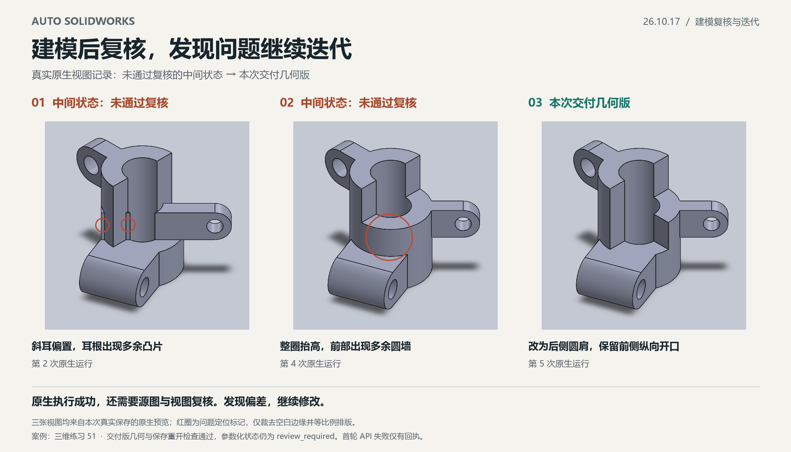

# Auto SolidWorks 26.10.17

本次更新重点：**建模后先复核，发现问题自行修正并继续迭代，不把首次生成的模型直接作为最终交付。**

## 新增与强化

### 建模结果复核与修改迭代

在 Codex 与插件配合的建模流程中，生成模型后会继续对照源图检查关键尺寸、孔位、特征方向、连接关系及必要视图。发现有明确依据的问题后，AI 会修正草案、重新编译并再次建模，复核后再决定是否交付。

原生建模执行成功只是一个阶段结果。局部几何通过检查，但视图与源图存在矛盾时，仍会继续修改。关键尺寸或拓扑无法确定时，会提出具体澄清，不把不确定内容擅自当作图纸事实。

### 保存重开与证据保留

最终交付保留原生保存、重新打开、重建、实体有效性与已声明尺寸/几何检查，并实际查看必要视图。失败回执、中间状态、修正记录和检查点会保留，便于追溯迭代原因；有剩余未通过项或参数化限制时，会如实说明。

### 整合最新本地工作流能力

- AI 直接看图，识别文字、尺寸端点和跨视图关系，取消本地 OCR 依赖。
- 源尺寸统一引用与表达式派生，校验单位、缺失前提及依赖关系。
- 已复核特征可分阶段建模；后台原生任务串行执行，按 request_id 查询结果。
- 经验证的检查点可用于续建；阶段完成与最终整图交付分别记录。
- 支持在固定毫米坐标中比较已声明源轮廓与模型投影，辅助定位差异。

## 实际迭代示例

下图来自本次“三维练习51”的真实原生视图，包含未通过视觉复核的中间状态及本次交付几何版：

- 中间状态一：斜耳偏置，耳根出现多余凸片；原生执行成功后，在视图复核中发现问题，继续修改。
- 中间状态二：将连接区整圈抬高，产生源图没有的前部圆墙；再次依据等轴测反证修正。
- 本次交付几何版：改为斜耳根后侧四分之一圆肩，保留前侧纵向开口，并通过保存重开与声明检查。

本案例共进行5次原生运行：1次原生执行失败，3个原生成功的中间候选未通过后续视觉复核，第5次形成交付几何版。记录的建模相关墙钟为12分16秒，包含识图绑定、编译、重试和必要复核；首次打点前准备及结束后报告整理未计入。建模时及保存重开后的17项声明检查均通过，草图参数化状态仍为 `review_required`，未宣称整件草图完全约束。

## 适用范围

自动复核与修改迭代由 **Codex 协同插件**完成：AI 负责识图、判断和修改方案，插件负责原生执行、回执与验证。它不保证任意图纸都能自动收敛，也不等同于完整制造图、BREP 或 GD&T 等价认证。

配图运行时为发布整理前的本地 `26.10.13-opt.1`，展示的是本次实际迭代流程；该案例不替代 `26.10.17` 安装包的独立构建与验收。本次发布安装包的构建、离线和公开MCP验证范围见[发布验证记录](release-validation-26.10.17.md)。

## 安装与下载

下载[26.10.17 Windows x64 插件包](https://github.com/qdaia/Auto-SolidWorks/releases/download/v26.10.17/auto-solidworks-26.10.17-windows-x64.zip)，解压后运行 install.ps1。SolidWorks及其Interop由本机安装提供。
